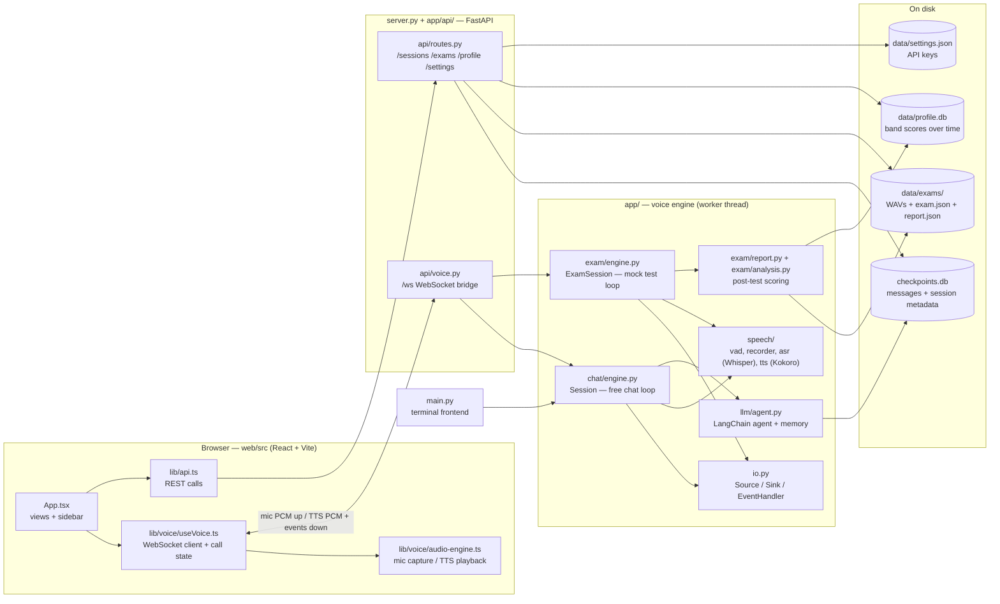
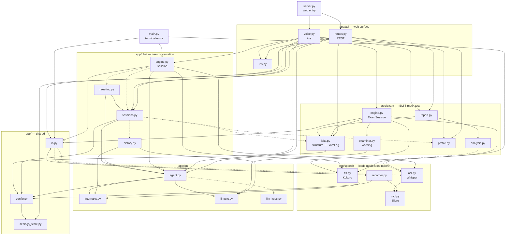
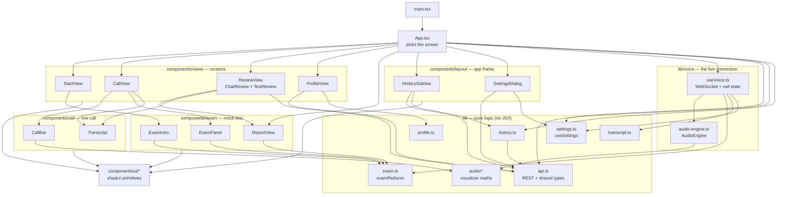
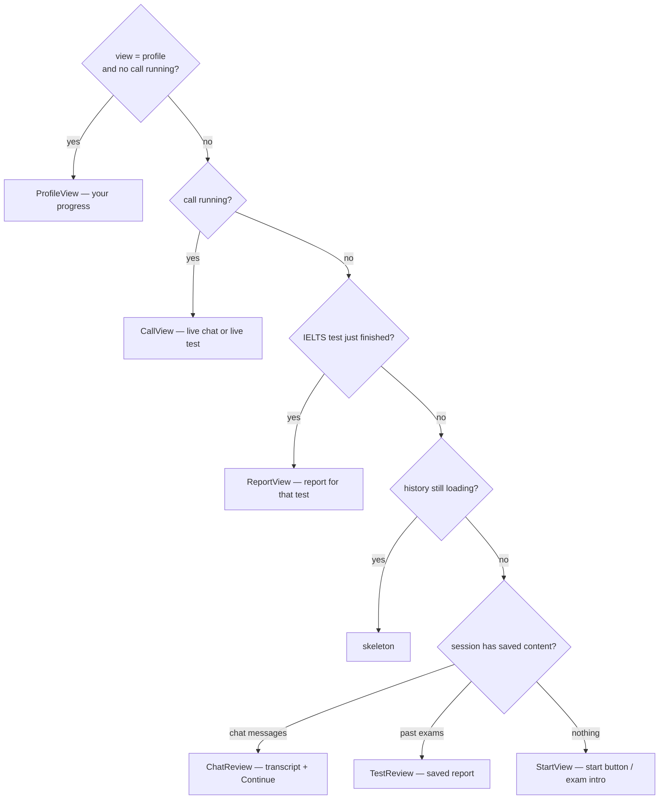
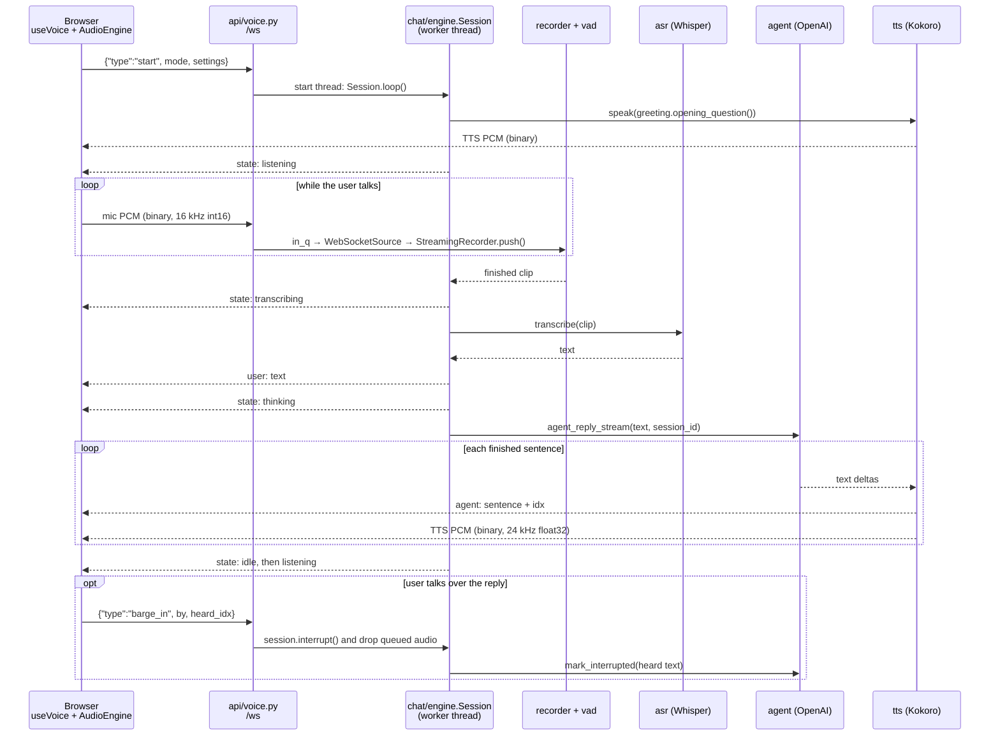
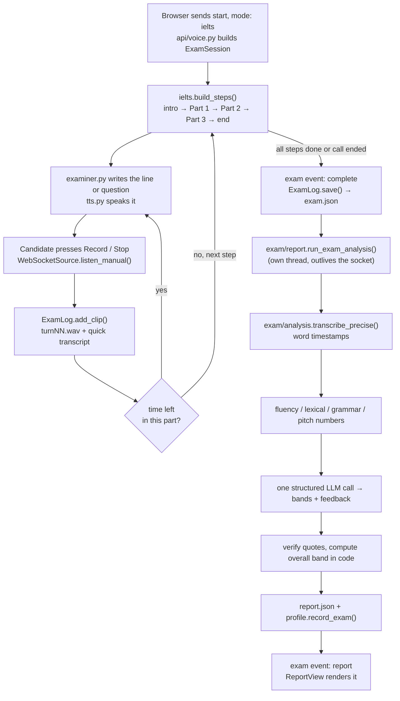

# speakIelts — code map

A navigation guide: what each file is for, how the pieces connect, and where to
go when you want to change something. `README.md` covers setup and running;
`TODO.md` is the design log (every change and why).

- [Folder layout](#folder-layout)
- [1. The whole system in one picture](#1-the-whole-system-in-one-picture)
- [2. "I want to change X" — where to look](#2-i-want-to-change-x--where-to-look)
- [3. Backend module graph](#3-backend-module-graph)
- [4. Frontend module graph](#4-frontend-module-graph)
- [5. One chat turn, step by step](#5-one-chat-turn-step-by-step)
- [6. One IELTS mock test, step by step](#6-one-ielts-mock-test-step-by-step)
- [7. The WebSocket protocol](#7-the-websocket-protocol)
- [8. Where data is stored](#8-where-data-is-stored)
- [9. Tests](#9-tests)
- [10. Things that will trip you up](#10-things-that-will-trip-you-up)

---

## Folder layout

```
main.py                  terminal entry point
server.py                web entry point (builds the FastAPI app)
app/
  config.py              .env + saved settings, PROJECT_ROOT
  settings_store.py      API keys in data/settings.json
  io.py                  AudioSource / Sink / EventHandler (shared by both engines)
  api/                   what the browser can call
    routes.py              REST
    voice.py               /ws — the live call
    ids.py                 id validation
  chat/                  free conversation
    engine.py              Session loop
    greeting.py  sessions.py  history.py
  exam/                  IELTS mock test
    ielts.py  examiner.py  engine.py        live
    analysis.py  report.py  profile.py      after the test
  speech/                vad.py  recorder.py  asr.py  tts.py
  llm/                   agent.py  interrupts.py  llmtext.py  llm_keys.py
tests/                   one script per backend module
web/
  public/worklets/       AudioWorklet (mic samples)
  src/
    App.tsx              picks the screen
    components/
      views/               full screens
      layout/              sidebar, settings dialog
      call/                call bar, transcript
      exam/                intro, live panel, report
      ui/                  shadcn primitives
      brand/               loader
    lib/
      voice/               useVoice.ts, audio-engine.ts — the live connection
      audio/               visualizer maths
      api.ts  exam.ts  transcript.ts  history.ts  profile.ts  settings.ts
    hooks/
  tests/                 node:test for the pure lib/ modules
```

Every `app/*/__init__.py` starts with a one-line index of the files beside it.

---

## 1. The whole system in one picture

Three layers. The browser only captures and plays audio; all speech and
language work happens in Python on the Mac.



The key idea: **`Session` and `ExamSession` never touch a microphone, a speaker
or a socket directly.** They are handed three objects (defined in
[app/io.py](app/io.py)) and call them:

| Interface | Job | Terminal (`main.py`) | Web (`app/api/voice.py`) |
|---|---|---|---|
| `AudioSource.listen()` | return the next recorded clip | `MicSource` | `WebSocketSource` |
| `Sink.write()` / `drain()` | play synthesized speech | `LocalSink` (in `speech/tts.py`) | `WebSocketSink` |
| `EventHandler.on_*()` | report state + transcript to the UI | `TerminalHandler` | `WebSocketHandler` |

That is why the same loop runs in the terminal and in the browser.

---

## 2. "I want to change X" — where to look

| I want to… | Start here |
|---|---|
| Change what Jessica is like / her system prompt / her tools | [app/llm/agent.py](app/llm/agent.py) |
| Change the chat turn order (listen → think → speak), goodbye words, stitching | [app/chat/engine.py](app/chat/engine.py) |
| Change the opening question of a call | [app/chat/greeting.py](app/chat/greeting.py) |
| Tune when the app decides you stopped talking (web) | [app/speech/recorder.py](app/speech/recorder.py) |
| Tune it for the terminal mic | `record_until_silence` in [app/speech/asr.py](app/speech/asr.py) |
| Change the Whisper model or transcript clean-up | `transcribe` / `clean_transcript` in [app/speech/asr.py](app/speech/asr.py) |
| Change the voice, or how text is split into spoken sentences | [app/speech/tts.py](app/speech/tts.py) |
| Change what happens when the user interrupts | [app/llm/interrupts.py](app/llm/interrupts.py), `interrupt` in [app/chat/engine.py](app/chat/engine.py), `barge_in` in [app/api/voice.py](app/api/voice.py) |
| Change exam structure or timings (parts, durations, short vs full) | [app/exam/ielts.py](app/exam/ielts.py) |
| Change what the examiner says or asks | [app/exam/examiner.py](app/exam/examiner.py) |
| Change how the test runs live (recording answers, countdowns) | [app/exam/engine.py](app/exam/engine.py) |
| Change the measured numbers (fluency, vocabulary, pitch…) | [app/exam/analysis.py](app/exam/analysis.py) |
| Change band estimation or the report's contents | [app/exam/report.py](app/exam/report.py) |
| Change the progress history / averages | [app/exam/profile.py](app/exam/profile.py) |
| Change session names, colours, summaries | [app/chat/sessions.py](app/chat/sessions.py) |
| Change API key handling | [app/settings_store.py](app/settings_store.py), [app/llm/llm_keys.py](app/llm/llm_keys.py) |
| Add or change a REST route | [app/api/routes.py](app/api/routes.py) |
| Change the WebSocket messages or call lifecycle | [app/api/voice.py](app/api/voice.py) and [web/src/lib/voice/useVoice.ts](web/src/lib/voice/useVoice.ts) |
| Change which screen is shown when | [web/src/App.tsx](web/src/App.tsx) (the `content` if/else chain) |
| Change the live call screen | [web/src/components/views/CallView.tsx](web/src/components/views/CallView.tsx), [CallBar.tsx](web/src/components/call/CallBar.tsx) |
| Change the exam screen during a test | [web/src/components/exam/ExamPanel.tsx](web/src/components/exam/ExamPanel.tsx), state in [web/src/lib/exam.ts](web/src/lib/exam.ts) |
| Change the report screen | [web/src/components/exam/ReportView.tsx](web/src/components/exam/ReportView.tsx) |
| Change the progress chart | [web/src/components/views/ProfileView.tsx](web/src/components/views/ProfileView.tsx), geometry in [web/src/lib/profile.ts](web/src/lib/profile.ts) |
| Change the sidebar | [web/src/components/layout/HistorySidebar.tsx](web/src/components/layout/HistorySidebar.tsx), grouping in [web/src/lib/history.ts](web/src/lib/history.ts) |
| Change browser mic capture / playback / barge-in detection | [web/src/lib/voice/audio-engine.ts](web/src/lib/voice/audio-engine.ts), [web/public/worklets/recorder-processor.js](web/public/worklets/recorder-processor.js) |
| Change client-side settings (pause length, voice interrupt) | [web/src/lib/settings.ts](web/src/lib/settings.ts), [SettingsDialog.tsx](web/src/components/layout/SettingsDialog.tsx) |

---

## 3. Backend module graph

Arrows mean "imports". Dashed arrows are lazy imports (done inside a function,
usually to avoid loading a model or to break a cycle).



### What each backend file does

**Entry points and `app/api/`**

| File | Role |
|---|---|
| [main.py](main.py) | Terminal app. Wires `MicSource` + `LocalSink` + `TerminalHandler` into a `Session` and runs it. 18 lines. |
| [server.py](server.py) | Builds the FastAPI app: includes the two routers below, then mounts `web/dist`. ~50 lines. |
| [app/api/routes.py](app/api/routes.py) | Every REST route. |
| [app/api/voice.py](app/api/voice.py) | The `/ws` endpoint: runs a `Session` or `ExamSession` in a worker thread and shuttles bytes/events through two queues. |
| [app/api/ids.py](app/api/ids.py) | Validation patterns for session / exam ids coming from the browser. |

**`app/chat/` and the two loops**

| File | Role |
|---|---|
| [app/chat/engine.py](app/chat/engine.py) | `Session.loop()` — the free-chat loop: listen → transcribe → agent → speak. Handles barge-in and "stitching" a continued utterance. |
| [app/exam/engine.py](app/exam/engine.py) | `ExamSession.loop()` — walks the fixed steps from `exam/ielts.py`, asks questions, records each answer, enforces the clock. Not interruptible. |

**`app/speech/` (plus `app/io.py`)**

| File | Role |
|---|---|
| [app/io.py](app/io.py) | The three interfaces (`AudioSource`, `Sink`, `EventHandler`) and their terminal + WebSocket implementations. Also the sentinels `QUIT`, `STOP`, `BACKFILL`. |
| [app/speech/recorder.py](app/speech/recorder.py) | `StreamingRecorder` — takes PCM chunks from the browser, runs VAD, decides when the user finished (two tiers: a "thinking pause" cue, then finalize). |
| [app/speech/asr.py](app/speech/asr.py) | Whisper transcription (`transcribe`), plus the terminal mic recorder (`record_until_silence`). Warm-loads the model on import. |
| [app/speech/vad.py](app/speech/vad.py) | Silero VAD: 512-sample chunk in, speech probability out. |
| [app/speech/tts.py](app/speech/tts.py) | Kokoro TTS. `speak()` for a fixed line, `speak_stream()` for streamed LLM text spoken sentence by sentence. Also `LocalSink` (speakers). |

**`app/llm/`**

| File | Role |
|---|---|
| [app/llm/agent.py](app/llm/agent.py) | Builds the LangChain agent (`model`, Tavily `search` tool, SQLite checkpointer). `agent_reply_stream()` yields text deltas; `mark_interrupted()` fixes memory after a cut-off. |
| [app/llm/interrupts.py](app/llm/interrupts.py) | Rewrites the last saved reply to only what the user actually heard, plus an `<interrupted/>` marker. `ReplyTracker` serialises this against the still-running stream. |
| [app/chat/greeting.py](app/chat/greeting.py) | The opening question: random for a new session, summary-based for a returning one. |
| [app/llm/llmtext.py](app/llm/llmtext.py) | Tiny helpers to pull plain text out of LangChain message content. |
| [app/llm/llm_keys.py](app/llm/llm_keys.py) | Swaps a new API key into already-built clients so no restart is needed. |

**`app/exam/`**

| File | Role |
|---|---|
| [app/exam/ielts.py](app/exam/ielts.py) | The exam as data: `Timing` (short/full), `Step` list, and `ExamLog` (saves WAVs + `exam.json`). No LLM. |
| [app/exam/examiner.py](app/exam/examiner.py) | Everything the examiner says: per-line instructions, fallbacks, cue-card generation, Part 1/2/3 question prompts. Takes any `llm`, so it is testable with a fake. |
| [app/exam/analysis.py](app/exam/analysis.py) | Pure maths on word timestamps and text: fluency, lexical, grammar counts, pitch, word confidence. |
| [app/exam/report.py](app/exam/report.py) | Orchestrates the post-test pipeline: re-transcribe → analyse → one structured LLM call → verify quotes, compute overall band → `report.json`. Also `list_exams` / `load_exam` for REST. |

**Storage and config**

| File | Role |
|---|---|
| [app/chat/sessions.py](app/chat/sessions.py) | Session metadata table (name, colour, summary, last used) in `checkpoints.db`; summaries; delete. |
| [app/chat/history.py](app/chat/history.py) | Converts saved LangGraph messages into plain chat messages for the UI. |
| [app/exam/profile.py](app/exam/profile.py) | `data/profile.db`: one row per scored test; averages and trend for the progress screen. |
| [app/settings_store.py](app/settings_store.py) | `data/settings.json`: API keys, never returned to the browser in full. |
| [app/config.py](app/config.py) | Loads `.env` + saved settings once; exposes `PROJECT_ROOT`, `OPENAI_MODEL`, etc. |

---

## 4. Frontend module graph

`components/ui/*` (shadcn primitives) and `lib/audio/*` (visualizer maths) are
leaf libraries and are collapsed into one node each.



### Which screen is shown

`App.tsx` chooses exactly one thing for the main area, in this order:



### Frontend files worth knowing

| File | Role |
|---|---|
| [web/src/App.tsx](web/src/App.tsx) | Top-level state (mode, sessions, view) and the screen chooser above. |
| [web/src/lib/voice/useVoice.ts](web/src/lib/voice/useVoice.ts) | The heart of the client. Owns the WebSocket, the `AudioEngine`, the call state machine, transcript, exam state, barge-in, and session switching. Largest frontend file (~500 lines). |
| [web/src/lib/voice/audio-engine.ts](web/src/lib/voice/audio-engine.ts) | `AudioEngine`: mic → 16 kHz Int16 for the server; plays 24 kHz float32 TTS; exposes levels for the visualizer. |
| [web/src/lib/exam.ts](web/src/lib/exam.ts) | `examReducer` — turns server `exam` events into UI state. Pure, tested. |
| [web/src/lib/api.ts](web/src/lib/api.ts) | Every REST call and the shared response types. |
| [web/src/lib/transcript.ts](web/src/lib/transcript.ts), [history.ts](web/src/lib/history.ts), [profile.ts](web/src/lib/profile.ts) | Small pure helpers, each with a test in `web/tests/`. |
| [web/src/lib/settings.ts](web/src/lib/settings.ts) | Browser-side settings (`useSettings`). |
| [web/public/worklets/recorder-processor.js](web/public/worklets/recorder-processor.js) | AudioWorklet that pulls raw mic samples off the audio thread. |

---

## 5. One chat turn, step by step



Everything from `E` to `B` goes through `out_q` and the `sender()` coroutine in
`app/api/voice.py`; everything from `B` to `E` goes through `in_q`.

---

## 6. One IELTS mock test, step by step



If the socket has already closed when the report finishes, the browser polls
`GET /exams/{session}/{exam}` instead (see the report polling in `lib/voice/useVoice.ts`).

---

## 7. The WebSocket protocol

Single endpoint: `/ws?session=<id>`. Defined in [app/api/voice.py](app/api/voice.py)
(`ws_endpoint`) and [web/src/lib/voice/useVoice.ts](web/src/lib/voice/useVoice.ts).

**Browser → server**

| Message | Meaning |
|---|---|
| `{"type":"start","mode":"chat"｜"ielts","exam_length":…,"settings":{…}}` | Begin the call. Nothing runs until this arrives. |
| binary | Mic audio: 16 kHz mono int16 PCM |
| `{"type":"barge_in","by":"voice"｜"button","heard_idx":n}` | Stop the current reply; `heard_idx` = last sentence that started playing |
| `{"type":"record_stop"}` | Exam only: the candidate finished their answer |
| `{"type":"settings","pause_s":n}` | Setting changed mid-call |
| `{"type":"quit"}` | End the call |

**Server → browser**

| Message | Meaning |
|---|---|
| `{"type":"state","state":…}` | `listening` · `transcribing` · `thinking` · `speaking` · `idle` |
| `{"type":"user","text":…}` | What Whisper heard |
| `{"type":"agent","text":…,"idx":n}` | One sentence about to be spoken |
| `{"type":"pause"}` | User paused mid-thought; mic stays open |
| `{"type":"exam","event":…}` | `start` · `step` · `part` · `cue_card` · `prep` · `talk` · `answer_window` · `answer_end` · `complete` · `analysing` · `report` · `report_failed` |
| `{"type":"error","message":…}` | Something failed; the session carries on |
| binary | TTS audio: 24 kHz mono float32 PCM |

**REST** (all in [app/api/routes.py](app/api/routes.py)): `/healthz`, `/settings`,
`/settings/keys`, `/sessions…`, `/profile`, `/ielts/schedule`, `/exams…`.

---

## 8. Where data is stored

Everything is local and git-ignored.

| Path | Written by | Contains |
|---|---|---|
| `checkpoints.db` | `llm/agent.py` (LangGraph checkpointer), `chat/sessions.py` | Conversation messages per session, plus the session metadata table |
| `data/exams/<session>/<exam>/` | `exam/ielts.py` (`ExamLog`), `exam/report.py` | `turnNN.wav`, `exam.json`, `report.json` |
| `data/profile.db` | `exam/profile.py` | One row per scored test |
| `data/settings.json` | `settings_store.py` | API keys (file mode: owner only) |
| `.env` | you | Fallback for API keys and overrides |
| browser `localStorage` | `lib/voice/useVoice.ts`, `lib/settings.ts` | Active session id, UI settings |

---

## 9. Tests

Backend tests are plain scripts (no pytest needed, no mic, no API keys):

```bash
python tests/test_engine_stitch.py
```

Frontend tests use Node's built-in runner (Node 22+):

```bash
node --test web/tests/
```

| Module | Test |
|---|---|
| `app/speech/asr.py` | `tests/test_asr.py` |
| `app/speech/vad.py` | `tests/test_vad.py` |
| `app/speech/recorder.py` | `tests/test_recorder.py` |
| `app/speech/tts.py` | `tests/test_tts.py` |
| `app/io.py` | `tests/test_io.py` |
| `app/chat/engine.py` | `tests/test_engine_stitch.py` |
| `app/llm/interrupts.py` | `tests/test_interrupts.py` |
| `app/chat/history.py` | `tests/test_history.py` |
| `app/exam/ielts.py` | `tests/test_ielts.py` |
| `app/exam/examiner.py` | `tests/test_examiner.py` |
| `app/exam/engine.py` | `tests/test_exam_engine.py` |
| `app/exam/analysis.py` | `tests/test_exam_analysis.py` |
| `app/exam/report.py` | `tests/test_exam_report.py` |
| `app/exam/profile.py` | `tests/test_profile.py` |
| `app/settings_store.py` | `tests/test_settings_store.py` |
| `web/src/lib/{exam,history,profile,transcript}.ts` | `web/tests/*.test.ts` |

No tests: `app/api/*`, `llm/agent.py`, `chat/sessions.py`, `chat/greeting.py`, `lib/voice/*`.

---

## 10. Things that will trip you up

- **Importing a module can load a model.** `app/speech/asr.py` warm-loads Whisper and
  `app/speech/tts.py` builds the Kokoro pipeline at import time; `app/llm/agent.py` builds
  the agent and opens `checkpoints.db`. That is why several imports are lazy
  (dashed arrows above) and why `app/__init__.py` imports nothing.
- **`chat/sessions.py` imports `llm/agent.py`**, so anything that touches session
  metadata also constructs the LLM client. `chat/engine.py` imports it lazily for
  this reason.
- **Two threads per call.** The engine loop blocks, so it runs in a worker
  thread; the asyncio side only moves items between the socket and two queues
  (`in_q`, `out_q`). `None` on `out_q` stops the sender; `QUIT` on `in_q` wakes
  the engine.
- **The `logger.info("<< ws frame …")` line in `ws_endpoint` (`app/api/voice.py`) is load-bearing**
  (see the comment there). Do not remove it as noise.
- **An IELTS session is recognised by its name.** The server renames the
  session to `IELTS mock test <date>` and the client's `sessionMode()` in
  `web/src/lib/history.ts` checks that prefix. Renaming a test session in the
  sidebar turns it into a "chat" as far as the UI is concerned.
- **Two entry files.** `main.py` is the terminal app, not the FastAPI app;
  `pyproject.toml` pins `server:app` so `fastapi dev` finds the right one.
- **Two files are both called `engine.py`** — `app/chat/engine.py` (`Session`)
  and `app/exam/engine.py` (`ExamSession`). Same role, different loop.
- **Data paths are computed from file locations** (`config.PROJECT_ROOT`,
  `settings_store.DEFAULT_PATH`, `exam/profile.py`'s `parents[2]`). Moving one of
  those files means fixing its path.
- **Dev vs built UI.** `server.py` serves `web/dist` on :8080. `npm run dev`
  serves on :5173 and proxies only `/ws` — REST calls from the Vite dev server
  are not proxied.
